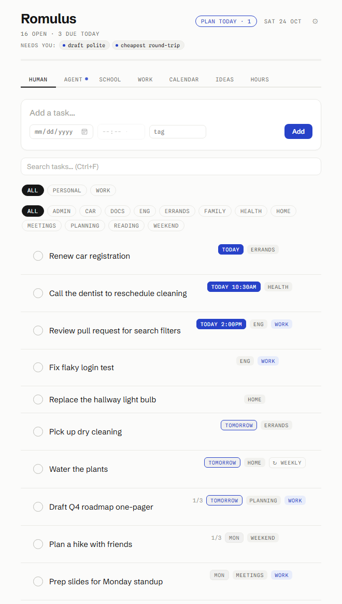
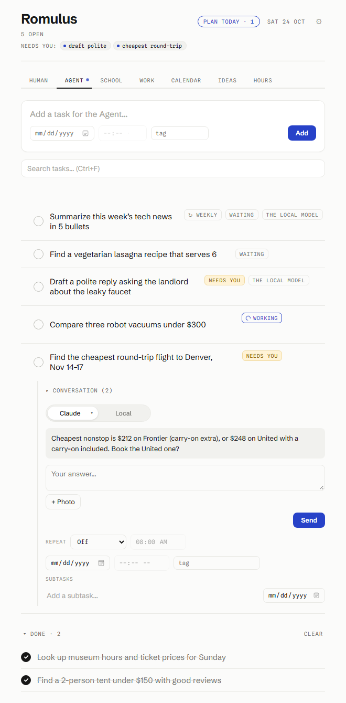

# Romulus

**Romulus killed Remus. This should kill your need for Meta Muse.**

**A to-do list with an agent in it.** Write a task the way you'd tell a person ("find the cheapest flight to Denver the weekend of the 14th", "order the groceries", "apply to these three internships", "draft a reply to the landlord"), hand it to the Agent, and it goes and does it: searches the web, reads pages, fills forms, compares prices, builds the cart, drafts the email. It comes back only when it needs a decision, and it **never buys, sends, submits or books anything until you reply "yes"** to the exact thing it described.

**Bring your own model.** Plug in whatever you already pay for or can run: a Claude or ChatGPT plan, an OpenRouter account (hundreds of models, some free), a Gemini key, the free tiers from Grok, Groq, Cloudflare or NVIDIA, or **your own model on your own hardware** through Ollama. Connect several and the app tries them in your order. Tasks that touch private things (bank, medical, passwords…) only ever go to your local model.

**Your money, without the subscription.** The Finance tab does what people pay Rocket Money, Monarch or Copilot for: every account in one place, recurring bills and subscriptions found automatically (and flagged when one stops), net worth over time, an income statement and balance sheet, receipts pulled from your inbox, live stock prices. The bank connection is read-only and costs about $15 a year; the data sits in an encrypted vault on your computer, not on anyone's server, and the Agent can't read it.

Plus a School list that pulls due dates from course calendars, an Ideas board, an Hours log, Google and Microsoft calendars, and an Android app that stays in sync.

<p align="center"></p>

## Install

**Windows:** download `Romulus-Setup-<version>.exe` from the [latest release](https://github.com/jamesbobdev-gif/tasks-releases/releases/latest) and run it. The installer isn't code-signed yet, so Windows warns: **More info → Run anyway**. Installed copies update themselves.

**Linux and macOS:** installers are built by the release workflow and attached to the same releases. The macOS build is unsigned, so the first open needs **System Settings → Privacy & Security → Open Anyway**.

**From source:** Node 18 or newer, then `npm install` and `npm start`.

Then read **[docs/SETUP.md](docs/SETUP.md)**: connecting an AI (every option, with the buttons to press), syncing with your phone, calendars, Finance, and where your keys live.

## What's in the box

<p align="center"> </p>
<p align="center"><sub>Made-up demo data.</sub></p>

| | |
|---|---|
| **Human** | Your own to-dos: due dates, times, tags, subtasks, repeats, drag to reorder, search. |
| **Agent** | Tasks the AI does. Live view of what it's doing, its questions, its results, the conversation. A pill on each task picks which AI. |
| **School** | Assignments, with due dates pulled from Blackboard or D2L calendar links; the class is the tag. |
| **Work** | A second list, synced with the rest. |
| **Calendar · Ideas · Hours** | Extra views: the month, a board of note cards, a log of hours per day. |
| **Finance** | A Rocket Money / Monarch replacement: accounts, recurring bills and subscriptions, net worth, statements, receipts from Gmail, live stock prices. Bank read-only through SimpleFIN. Encrypted twice, locks itself, never leaves the computer. |

What the Agent can do today: research and writing; shopping on Amazon and Walmart (groceries included) with the cart built and held for your yes; flights, tickets and bookings with a seat map you can override; forms and job applications filled from a **Locked** profile only your local model may read; email through Claude; a morning look-ahead over your calendar and inbox; memory of what you've said and what worked on each site; its own headless browser you can watch and take over.

## Privacy, in short

Everything you connect stays on the computer where you connected it. Keys, tokens and sync keys are encrypted with the operating system's own encryption and never synced. The Locked profile and Finance are never given to a cloud AI. Sync goes through a Supabase project *you* own, and the sync table is closed to anyone without the list's key. There is no telemetry. Details in [SECURITY.md](SECURITY.md).

---

## Working on the code

```
npm install
npm start        # dev mode
npm test         # unit tests (Node's built-in runner, files in test/)
npm run dist     # installer into dist/
```

- `main.js` starts the Electron main process and wires the modules: each gets what it shares with the others through `init(ctx)` and lists its IPC calls in `handlers`.
- `main/` is the desktop plumbing: window and tray, saving tasks, config and encrypted secrets (`store.js`), calendar sync and accounts, Gmail dates, the morning look-ahead, Finance, the hub.
- `agent/` is the Agent: routing between lanes, the Claude runner, the other cloud AIs (`providers.js`), the local-model lane and its tools and browser, AI connections (`ai-connections.js`, `claude-auth.js`, `openrouter-connect.js`), the usage-limit hold, the weekly memory tidy, skills and site notes.
- `preload.js` is the bridge between the two.
- `renderer/` is the UI. `index.html` holds the markup, `styles.css` the look, `js/*.js` the page scripts. Plain scripts, no bundler: they share one global scope and load in the order `index.html` lists them, ending with `init.js`. Declare a top-level name in one file only.
- `mobile/` wraps the same UI in Capacitor for Android. `supabase/` holds the sync project's SQL (`setup.sql` is the one-paste version) and edge functions. `minipc/` has scripts for running the model or the whole agent on a second machine ([docs/second-machine.md](docs/second-machine.md)).

[CONTRIBUTING.md](CONTRIBUTING.md) has the ground rules; the one that matters most is that the Agent's "ask before anything final" stays enforced in code.

### Sign-in clients

One-click Google and Microsoft sign-in needs the app's own OAuth clients in `oauth-clients.json` (see `oauth-clients.example.json`; git-ignored). The official builds carry the maintainer's. A build without one still works: people paste their own Google Cloud credential in Settings → Calendars.

### Releases

`npm run release` bumps the version, builds the Windows installer on this machine and publishes it to the public releases repository named in `package.json` → `build.publish`, where installed copies look for updates. Pushing a `v*` tag runs `.github/workflows/release.yml` instead, which builds Windows, Linux and macOS on GitHub's runners; it needs a `RELEASES_TOKEN` secret with write access to that repository (and optionally `OAUTH_CLIENTS_JSON`).

Never add `seed-config.json` or `oauth-clients.json` to a build you share, and never share an APK built with your own `mobile/sync-config.json`: both hold keys to your lists.

### Phone app (Android)

```
cd mobile
node prepare-www.js        # copies renderer/ and bakes in sync-config.json
npx cap sync android
cd android && ./gradlew assembleDebug
```

Needs `JAVA_HOME` (JDK 21) and `ANDROID_HOME`. The APK lands in `mobile/android/app/build/outputs/apk/debug/`; it updates an installed copy in place.

### Where your data lives

Tasks are in `tasks.json` in the app's user-data folder (`%APPDATA%\Tasks` on Windows, `~/Library/Application Support/Tasks` on macOS, `~/.config/Tasks` on Linux). Back up that one file. Config and keys are in `config.json` next to it, secrets encrypted.

### Desktop behaviour

The installed app starts at login (toggle in the tray menu), hides to the tray when closed, and reappears when the screen wakes or unlocks. Windows won't let an app pin itself: Start menu → right-click **Tasks** → Pin to taskbar.

### Theme

⚙ Settings → **Theme** takes CSS. The whole look is CSS variables, so a re-skin is a handful of overrides:

```css
:root{
  --bg:#16161D; --surface:#1F1F28; --ink:#E6E6EA;
  --muted:#9C9CA8; --faint:#6E6E7A; --hairline:#33333E;
  --chip:#2A2A35; --accent:#8FA3FF;
}
```

### Quick reference

- Enter adds a task (date, time and tag are optional and stay sticky for batch entry)
- `/` jumps to the input · Ctrl+F (Cmd+F) searches
- ↑/↓ select · Space completes · Enter expands · Delete removes · Esc deselects
- Drag the dots on a row's left edge to reorder; click a tag chip to filter
- Hover a row for edit / expand / delete; overdue and due-today rows get a snooze button
- Ideas: + Add an idea in a group; drag cards between groups; highlight lines in a description for **→ To-do** or **→ Agent**

## License

[MIT](LICENSE).
